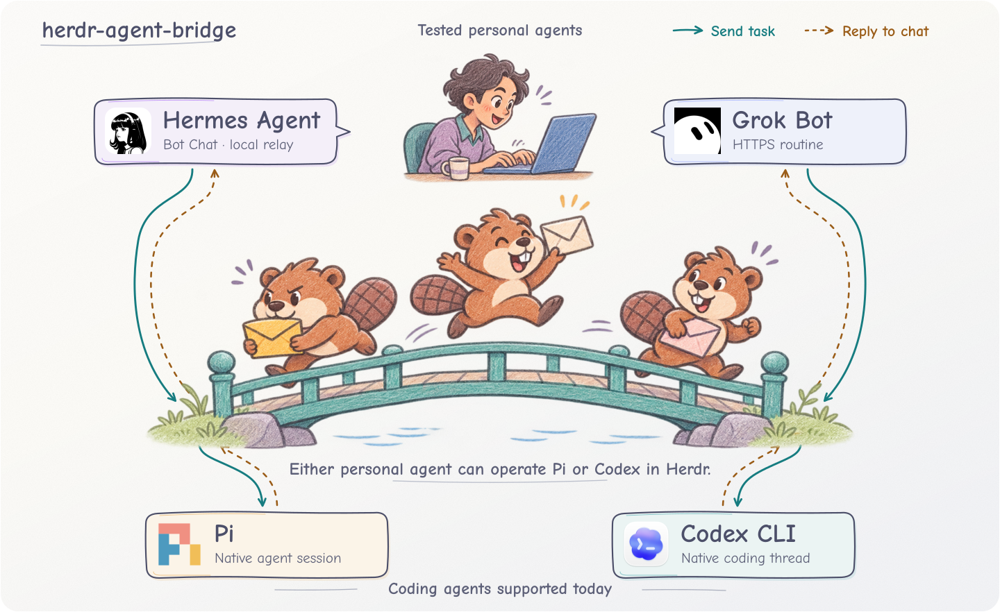
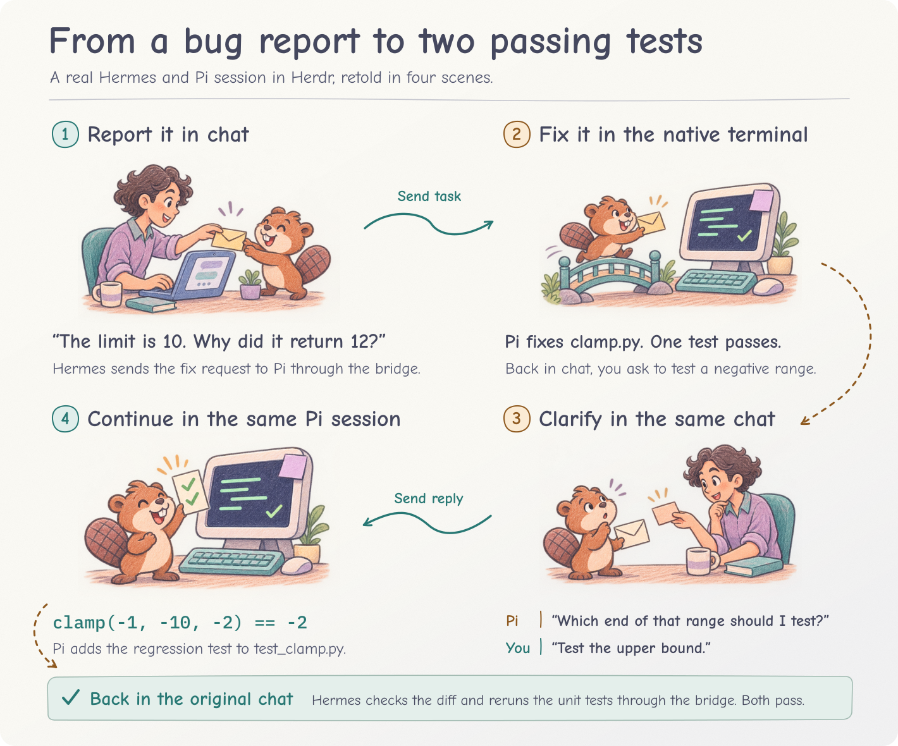

# herdr-agent-bridge

English · [简体中文](README.zh-CN.md)


**Let your personal agent operate another agent in its native terminal.** In Herdr App, you and your personal agent can work with the same running coding session. The coding agent keeps its usual tools and settings. Your personal agent can send a task, inspect what changed and decide what to ask next. You can open that terminal and take over.



## Why I built it

Herdr App is where I do my development work. When a coding agent finishes a fix, I usually read the diff, look at the test output and decide whether to ask for one more edge case. I wanted my personal agent to do that part the way I do it, with the project and the conversation still in front of it. The bridge gives it access to that working session and the evidence it needs to make the next decision.

## A task from chat to checkout



| When you need to… | What the bridge gives you |
| --- | --- |
| Use a feature of the native TUI | Bind the terminal to a Herdr App space. Your personal agent can invoke supported native commands there, such as naming a Pi session with `/name` or enabling Codex Fast with `/fast`. You can watch the effect in the same terminal. |
| Follow up on a fix | A request keeps its native session and parent round. Ask for the next change without pasting the previous conversation. |
| Check the agent's work | The bridge compares the worktree to its baseline, checks the allowed paths and records the exit status of your named commands. You can inspect the evidence before accepting a change. |
| Work on two projects | Independent projects can run concurrently. One active development task per project prevents two bound callers from writing the same project at once when its shared task slot is enabled. |
| Take over or reconnect | Pause automatic input, use the TUI yourself and hand the same session back after checking its state. Permission and trust prompts remain yours to answer. If a send times out, inspect the original request before retrying. |

## Try it locally

Install the **required runtime** [herdr-core](https://github.com/herdrdev/herdr-core#install) on the machine that runs the coding sessions. The bridge uses its `hc` executable to open and control terminals. The tested Linux baseline is `hc 0.1.22`. Install [uv](https://docs.astral.sh/uv/getting-started/installation/) to manage the Python CLI.

Use uv to install the CLI from [PyPI](https://pypi.org/project/herdr-agent-bridge/).

```sh
hc --version
uv tool install herdr-agent-bridge
export PATH="$(uv tool dir --bin):$PATH"
herdr-bridge --version
herdr-bridge tool smoke_hc --output "$(mktemp -d)/results.json"
```

Expect `herdr-bridge 0.1.1` and a JSON result with `"passed": true`. The smoke sends a task and a follow-up to a small local program, checks that blocked input is refused and cleans up its own terminal. It requires no bot, model or API key. Each invocation writes its report to a new temporary directory and prints the path.

**Give this to your agent:** “Follow the [installation guide](https://github.com/M1racleShih/herdr-agent-bridge/blob/main/docs/INSTALL.md). Install the CLI with uv and run the local smoke. Show me the version and checks before connecting a bot or using a model.”

For a first coding task, select an authenticated Pi or Codex CLI and a disposable Git project. Register a named check, set the allowed files, submit a round and verify the result using the [project guide](docs/PROJECT.md). The [installation guide](docs/INSTALL.md) also covers installing a release wheel and finding the bundled agent skill.

<a id="compatibility"></a>

## Which agents can work together?

In principle, any agent that can call the project entry can direct another agent with a compatible session adapter. The first application is software development. A **personal agent** manages the task through an authorized project entry. A **coding agent** does the work in its native session. Extending the caller side means connecting another personal agent to the project entry and arranging how results get back to it. Extending the execution side means adding an adapter that can launch an agent, direct input to the right session and recognize its replies.

- **Tested personal agents.** Hermes Agent (Desktop Bot Chat) and Grok Bot have each dispatched work to both supported coding agents and received verified results in the original chat.
- **Supported coding agents in 0.1.1.** Pi and Codex CLI. The table lists the execution modes and native commands exposed by their adapters.

| Execution mode | Pi | Codex CLI |
| --- | --- | --- |
| Read-only tasks with correlated replies | Isolated SDK | Isolated CLI |
| Development in the normal agent environment | Native | Native |
| Development with the restricted SDK tool set | Supported | Unavailable |
| Direct native commands through the bridge | `/name` | `/fast`, `/goal`, `/model` |

The Linux integration baseline includes herdr-core 0.1.22, Pi 1.5.2 and Codex CLI 0.171.0. Hermes uses a local relay. Grok needs its desktop device connection and an HTTPS routine. Allow for device disconnects during callbacks.

Python 3.11+ is required. The Linux and macOS local smoke supports a POSIX terminal. The real-agent baseline covers Linux. Pi requires Node.js and a short, linear history for result correlation. A fork, compaction or unsupported context edit can stop verification. We plan to support more personal agents and coding agents. To contribute an integration, start with the [caller binding](docs/PROJECT.md) or the [coding-agent adapter guide](docs/DEVELOPMENT.md#adding-an-agent-adapter).

## Guides

| Goal | Start here |
| --- | --- |
| Install, diagnose PATH issues or locate the skill | [Installation](docs/INSTALL.md) |
| Bind one or more projects, submit, verify or recover | [Project operations](docs/PROJECT.md) |
| Connect a chat and handle completion notifications | [Bot instructions](docs/PROJECT_BOT_TEMPLATE.md) · [Grok management](docs/GROK.md) |
| Inspect native evidence, contracts or takeover controls | [Pi integration](docs/PI.md) · [Development tasks](docs/DEVELOPMENT.md) |
| Give an agent the operating instructions | [Bundled skill](skills/herdr-agent-bridge/SKILL.md) |
| Run the suite or contribute an adapter | [Contributing](CONTRIBUTING.md) · [Security](SECURITY.md) |

[Release notes](CHANGELOG.md) · [Apache-2.0 license](LICENSE) · [Logo assets](assets/brand/README.md)
