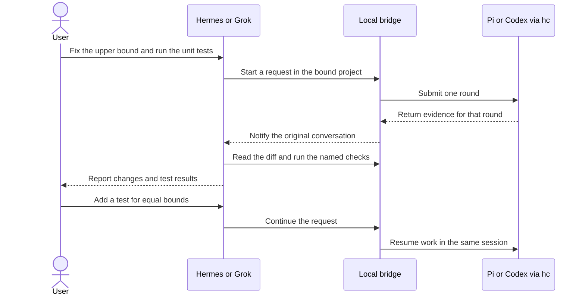

# herdr-agent-bridge

English · [简体中文](README.zh-CN.md)


Run Pi or Codex on your machine from a Hermes or Grok chat. Ask for a change, let the agent work in a local terminal, and get the diff and check results back in the conversation that asked for them.

## A task from chat to checkout



| When you need to… | What the bridge gives you |
| --- | --- |
| Follow up on a fix | A request keeps its native session and parent round. Ask for the next change without pasting the previous conversation. |
| Check the agent's work | The bridge compares the worktree to its baseline, checks the allowed paths and records the exit status of your named commands. You can inspect the evidence before accepting a change. |
| Work on two projects | Independent projects can run concurrently. One active development task per project prevents two bound callers from writing the same project at once when its shared task slot is enabled. |
| Take over or reconnect | Pause automatic input, inspect the live terminal and hand it back after reconciling the session. If a send times out, inspect the original request before retrying. |

## Try it locally

Install the **required runtime** [herdr-core](https://github.com/herdrdev/herdr-core#install) on the machine that runs the coding sessions. The bridge uses its `hc` executable to open and control terminals. The tested Linux baseline is `hc 0.1.22`. Install [uv](https://docs.astral.sh/uv/getting-started/installation/) to manage the Python CLI.

The first PyPI upload is pending. Install the verified 0.1.0 GitHub Release wheel now. Once 0.1.0 is on PyPI, the equivalent command is `uv tool install --python 3.11 'herdr-agent-bridge==0.1.0'`.

```sh
hc --version
uv tool install --python 3.11 'https://github.com/M1racleShih/herdr-agent-bridge/releases/download/v0.1.0/herdr_agent_bridge-0.1.0-py3-none-any.whl'
export PATH="$(uv tool dir --bin):$PATH"
herdr-bridge --version
herdr-bridge tool smoke_hc --output "$(mktemp -d)/results.json"
```

Expect `herdr-bridge 0.1.0` and a JSON result with `"passed": true`. The smoke sends a task and a follow-up to a small local program, checks that blocked input is refused and cleans up its own terminal. It requires no bot, model or API key. Each invocation writes its report to a new temporary directory and prints the path.

**Give this to your agent:** “Follow the [installation guide](https://github.com/M1racleShih/herdr-agent-bridge/blob/main/docs/INSTALL.md). Install the CLI with uv and run the local smoke. Show me the version and checks before connecting a bot or using a model.”

For a first coding task, select an authenticated Pi or Codex CLI and a disposable Git project. Register a named check, set the allowed files, submit a round and verify the result using the [project guide](docs/PROJECT.md). The [installation guide](docs/INSTALL.md) also covers installing a release wheel and finding the bundled agent skill.

<a id="compatibility"></a>

## Compatibility

| Execution mode | Pi | Codex CLI |
| --- | --- | --- |
| Read-only tasks with correlated replies | Isolated SDK | Isolated CLI |
| Development in the normal agent environment | Native | Native |
| Development with the restricted SDK tool set | Supported | Unavailable |
| Direct native commands through the bridge | `/name` | `/fast`, `/goal`, `/model` |

The Linux integration baseline includes herdr-core 0.1.22, Pi 1.5.2 and Codex CLI 0.171.0. Hermes Desktop and Grok Bot have each dispatched work to both native agents and received verified results back in the original chat. Hermes uses a local relay. Grok needs its desktop device connection and an HTTPS routine. Allow for device disconnects during callbacks.

Python 3.11+ is required. The Linux and macOS local smoke supports a POSIX terminal. The real-agent baseline covers Linux. Pi requires Node.js and a short, linear history for result correlation. A fork, compaction or unsupported context edit can stop verification. Other agent adapters are open for contribution.

## Guides

| Goal | Start here |
| --- | --- |
| Install, diagnose PATH issues or locate the skill | [Installation](docs/INSTALL.md) |
| Bind one or more projects, submit, verify or recover | [Project operations](docs/PROJECT.md) |
| Connect a chat and handle completion notifications | [Bot instructions](docs/PROJECT_BOT_TEMPLATE.md) · [Grok management](docs/GROK.md) |
| Inspect native evidence, contracts or takeover controls | [Pi integration](docs/PI.md) · [Development tasks](docs/DEVELOPMENT.md) |
| Give an agent the operating instructions | [Bundled skill](skills/herdr-agent-bridge/SKILL.md) |
| Run the suite or contribute an adapter | [Contributing](CONTRIBUTING.md) · [Security](SECURITY.md) |

[Release notes](CHANGELOG.md) · [Apache-2.0 license](LICENSE) · [Logo assets](assets/brand/README.md)
