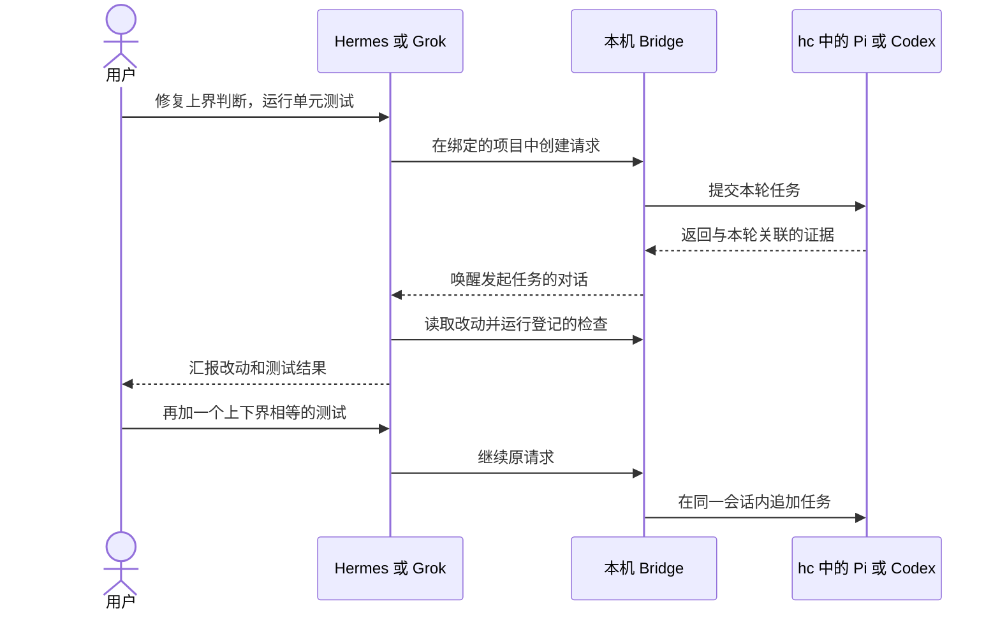

# herdr-agent-bridge

[English](README.md) · 简体中文


从 Hermes 或 Grok 对话里，让本机的 Pi 或 Codex 改代码。你在对话里提需求，编码 Agent 在本机终端工作，改了哪些文件、检查有没有通过，都能回到发起任务的原对话。

## 一次任务如何往返



| 你想做的事 | Bridge 能帮什么忙 |
| --- | --- |
| 沿着一次修复继续追问 | 请求保留原生会话和父轮次。可以直接追加要求，省去复制前一轮上下文。 |
| 核实 Agent 的改动 | Bridge 把工作区与基线比较，检查文件范围，并记录指定命令的退出码。接受改动前就能看到依据。 |
| 同时推进两个项目 | 独立项目可并行。启用共享任务占位后，同一项目一次只处理一个开发任务，防止两个已绑定入口同时写入。 |
| 中途接手或断线恢复 | 暂停自动输入，在原终端查看或接管，再核对会话并交还。发送超时后可以先查原请求，避免重复派单。 |

## 在本机试用

先安装 [uv](https://docs.astral.sh/uv/getting-started/installation/) 和 [herdr-core](https://github.com/herdrdev/herdr-core#install)（`hc`），确保 Git 在 PATH 中，然后运行：

```sh
uv tool install --python 3.11 'git+https://github.com/M1racleShih/herdr-agent-bridge.git@v0.1.0'
export PATH="$(uv tool dir --bin):$PATH"
herdr-bridge --version
herdr-bridge tool smoke_hc --output "$(mktemp -d)/results.json"
```

预期看到 `herdr-bridge 0.1.0`，以及包含 `"passed": true` 的 JSON。这个示例向本机小程序提交任务、追加一轮，确认阻塞状态下会拒绝输入，并清理自己的终端。无需 Bot、模型或 API 密钥。每次运行都把报告写入一个新的临时目录，并输出路径。

**也可以把这句话发给你的 Agent：**“按 [v0.1.0 安装指南](https://github.com/M1racleShih/herdr-agent-bridge/blob/v0.1.0/docs/INSTALL.zh-CN.md) 用 uv 安装 CLI，运行本地 smoke。先给我看版本和检查结果，再接 Bot 或调用模型。”

第一次跑真实编码任务时，选一个已完成认证的 Pi 或 Codex CLI，并准备一个临时 Git 项目。按[项目操作指南](docs/PROJECT.zh-CN.md)登记检查、限定文件范围、提交一轮并核验结果。[安装指南](docs/INSTALL.zh-CN.md)还说明了怎样安装 Release 中的 wheel 和定位随包分发的 Agent skill。

<a id="compatibility"></a>

## 兼容范围

| 运行模式 | Pi | Codex CLI |
| --- | --- | --- |
| 执行只读任务并关联回复 | 隔离 SDK | 隔离 CLI |
| 在日常 Agent 环境开发 | 原生 | 原生 |
| 使用受限 SDK 工具集开发 | 支持 | 不支持 |
| 通过 Bridge 发送原生命令 | `/name` | `/fast`、`/goal`、`/model` |

Linux 集成实测涵盖 herdr-core 0.1.22、Pi 1.5.2 和 Codex CLI 0.171.0。Hermes Desktop 和 Grok Bot 都已分别向两个原生 Agent 派单，并在原对话收到经核验的结果。Hermes 走本机中继，Grok 需要在线的桌面设备和 HTTPS 例程。设备断连会影响回调处理。

需要 Python 3.11+。本地 smoke 支持 Linux、macOS 的 POSIX 终端；真实 Agent 集成在 Linux 上实测。Pi 需要 Node.js，结果关联适用于较短的线性会话。分支、上下文压缩或不支持的上下文编辑可能导致核验停止。欢迎贡献其他 Agent 的适配。

## 使用指南

| 目标 | 入口 |
| --- | --- |
| 安装、排查 PATH 或找到 skill | [安装指南](docs/INSTALL.zh-CN.md) |
| 绑定一个或多个项目、派单、核验或恢复 | [项目操作](docs/PROJECT.zh-CN.md) |
| 接入对话并处理完成通知 | [Bot 指令模板](docs/PROJECT_BOT_TEMPLATE.zh-CN.md) · [Grok 管理接口](docs/GROK.zh-CN.md) |
| 查看原生证据、开发约束或接管操作 | [Pi 接入](docs/PI.zh-CN.md) · [开发任务](docs/DEVELOPMENT.zh-CN.md) |
| 向 Agent 提供按需操作说明 | [随包分发的 skill](skills/herdr-agent-bridge/SKILL.md) |
| 运行测试或贡献适配器 | [贡献指南](CONTRIBUTING.zh-CN.md) · [安全报告](SECURITY.zh-CN.md) |

[发行说明](CHANGELOG.zh-CN.md) · [Apache-2.0 许可证](LICENSE) · [Logo 素材](assets/brand/README.zh-CN.md)
