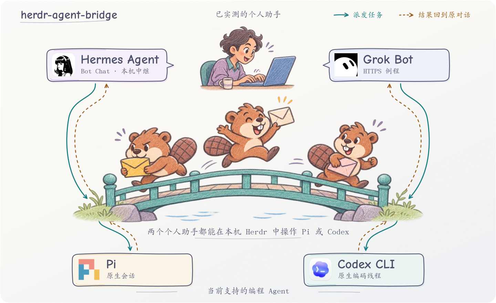
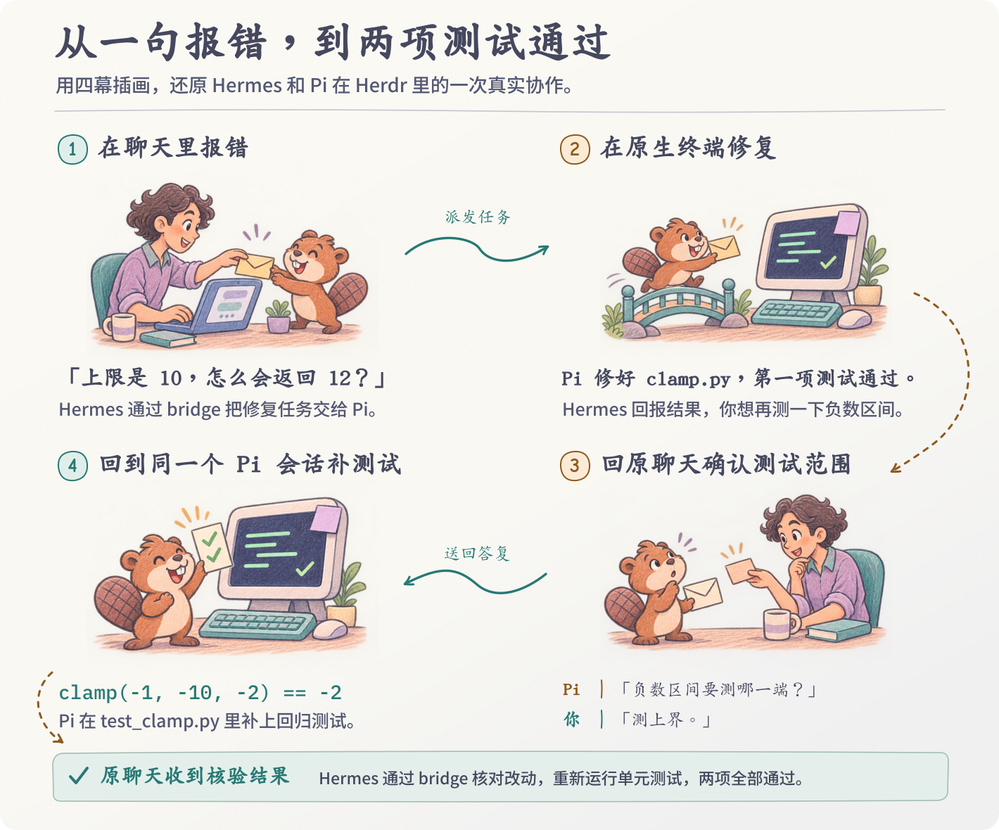

# herdr-agent-bridge

[English](README.md) · 简体中文


**让你的 Personal Agent 在原生终端里操作另一个 Agent。** 在 Herdr App 中，你和 Personal Agent 可以先后操作同一个编码会话。编码 Agent 继续使用自己的工具和配置。Personal Agent 可以派任务、看改动、决定下一轮问什么，你也能打开那个终端，随时接手。



## 为什么做这个项目

我平时就在 Herdr App 里开发。编码 Agent 修完一个问题，我通常会看一眼 diff 和测试输出，再决定要不要让它补一个边界用例。我想做一个自己的 Personal Agent，能像我一样判断下一步，并直接在我用的终端里操作。这个 bridge 让它能看到判断所需的证据，也让它能回到原会话，把下一步做下去。

## 一次任务如何往返



| 你想做的事 | Bridge 能帮什么忙 |
| --- | --- |
| 使用原生终端界面（TUI）的功能 | 把终端绑定到 Herdr App 的工作空间。Personal Agent 可以在这里发送已支持的原生命令，例如用 `/name` 给 Pi 会话命名，用 `/fast` 开启 Codex Fast。你能在同一个终端看到操作效果。 |
| 沿着一次修复继续追问 | 请求保留原生会话和父轮次。可以直接追加要求，省去复制前一轮上下文。 |
| 核实 Agent 的改动 | Bridge 把工作区与基线比较，检查文件范围，并记录指定命令的退出码。接受改动前就能看到依据。 |
| 同时推进两个项目 | 独立项目可并行。启用共享任务占位后，同一项目一次只处理一个开发任务，防止两个已绑定入口同时写入。 |
| 中途接手或断线恢复 | 暂停自动输入，在原终端亲自操作，核对会话状态后再交还。权限和信任提示由人处理。发送超时后可以先查原请求，避免重复派单。 |

## 在本机试用

Bridge 需要单独安装的运行时 **herdr-core**，它提供 [`hc` 命令](https://github.com/herdrdev/herdr-core#install)。请在运行编码会话的机器上单独安装它，并将 `hc` 加入 PATH。Bridge 使用 `hc` 创建和控制终端，Linux 实测版本为 `0.1.22`。Python CLI 由 [uv](https://docs.astral.sh/uv/getting-started/installation/) 安装管理。

使用 uv 从 [PyPI](https://pypi.org/project/herdr-agent-bridge/) 安装命令行工具。

```sh
hc --version
uv tool install herdr-agent-bridge
export PATH="$(uv tool dir --bin):$PATH"
herdr-bridge --version
herdr-bridge tool smoke_hc --output "$(mktemp -d)/results.json"
```

预期看到 `herdr-bridge 0.1.1`，以及包含 `"passed": true` 的 JSON。这个示例向本机小程序提交任务、追加一轮，确认阻塞状态下会拒绝输入，并清理自己的终端。无需 Bot、模型或 API 密钥。每次运行都把报告写入一个新的临时目录，并输出路径。

**也可以把这句话发给你的 Agent：**“按 [安装指南](https://github.com/M1racleShih/herdr-agent-bridge/blob/main/docs/INSTALL.zh-CN.md) 用 uv 安装 CLI，运行本地 smoke。先给我看版本和检查结果，再接 Bot 或调用模型。”

第一次跑真实编码任务时，选一个已完成认证的 Pi 或 Codex CLI，并准备一个临时 Git 项目。按[项目操作指南](docs/PROJECT.zh-CN.md)登记检查、限定文件范围、提交一轮并核验结果。[安装指南](docs/INSTALL.zh-CN.md)还说明了怎样安装 Release 中的 wheel 和定位随包分发的 Agent skill。

<a id="compatibility"></a>

## 哪些 Agent 可以协作？

原则上，只要一个 Agent 能调用项目入口，另一个 Agent 的会话有对应适配器，两者就可以通过 bridge 协作。这个项目首先解决的是软件开发场景。**Personal Agent** 通过获授权的项目入口管理任务，**编码 Agent** 在自己的原生会话里执行。接入新的管理端，需要让它调用项目入口，并能接收执行结果。接入新的执行端，需要适配它的启动方式、输入目标和原生回复，确保每次操作都落在正确的会话里。

- **已实测的 Personal Agent** 有 Hermes Agent（Desktop Bot Chat）和 Grok Bot。两者都分别向下表中的两个编码 Agent 派过单，并在原对话收到经核验的结果。
- **0.1.1 当前支持的编码 Agent** 有 Pi 和 Codex CLI。下表列出各适配器支持的运行模式，以及 Personal Agent 可通过 bridge 发送的原生命令。

| 运行模式 | Pi | Codex CLI |
| --- | --- | --- |
| 执行只读任务并关联回复 | 隔离 SDK | 隔离 CLI |
| 在日常 Agent 环境开发 | 原生 | 原生 |
| 使用受限 SDK 工具集开发 | 支持 | 不支持 |
| 通过 Bridge 发送原生命令 | `/name` | `/fast`、`/goal`、`/model` |

Linux 集成实测涵盖 herdr-core 0.1.22、Pi 1.5.2 和 Codex CLI 0.171.0。Hermes 走本机中继，Grok 需要在线的桌面设备和 HTTPS 例程。设备断连会影响回调处理。

需要 Python 3.11+。本地 smoke 支持 Linux、macOS 的 POSIX 终端；真实 Agent 集成在 Linux 上实测。Pi 需要 Node.js，结果关联适用于较短的线性会话。分支、上下文压缩或不支持的上下文编辑可能导致核验停止。我们计划接入更多 Personal Agent 和编码 Agent。贡献新接入时，可从[管理端项目绑定](docs/PROJECT.zh-CN.md)或[编码 Agent 适配指南](docs/DEVELOPMENT.zh-CN.md#新增-agent-适配)开始。

## 使用指南

| 目标 | 入口 |
| --- | --- |
| 安装、排查 PATH 或找到 skill | [安装指南](docs/INSTALL.zh-CN.md) |
| 绑定一个或多个项目、派单、核验或恢复 | [项目操作](docs/PROJECT.zh-CN.md) |
| 接入对话并处理完成通知 | [Bot 指令模板](docs/PROJECT_BOT_TEMPLATE.zh-CN.md) · [Grok 管理接口](docs/GROK.zh-CN.md) |
| 查看原生证据、开发约束或接管操作 | [Pi 接入](docs/PI.zh-CN.md) · [开发任务](docs/DEVELOPMENT.zh-CN.md) |
| 向 Agent 提供按需操作说明 | [随包分发的 skill](skills/herdr-agent-bridge/SKILL.md) |
| 运行测试或贡献适配器 | [贡献指南](CONTRIBUTING.zh-CN.md) · [安全报告](SECURITY.zh-CN.md) |

[发行说明](CHANGELOG.zh-CN.md) · [Apache-2.0 许可证](LICENSE) · [Logo 素材](assets/brand/README.zh-CN.md)
